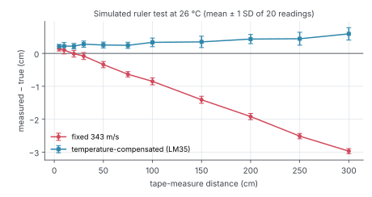
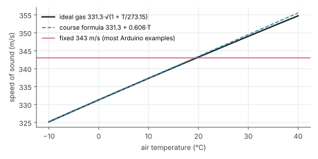

# Ultrasonic vs LiDAR

**Physics course project** · University of Debrecen, Faculty of Informatics · Arduino + MATLAB (also runs in GNU Octave) · **simulated so far; hardware test planned for the December lab day**

An HC-SR04 ultrasonic sensor measures distance by timing an echo, d = v·t/2, so its accuracy is only as good as the speed of sound it assumes. Most Arduino examples use a fixed 343 m/s, which is right only at about 20 °C. This project builds a temperature-compensated meter (HC-SR04 + LM35 on an Arduino), works out its error budget, checks the speed of sound independently with two phones (phyphox), and compares it with a LiDAR on targets where one of the two physical principles (sound or light) fails.

- [x] Arduino sketch: median of 5 pings, LM35 temperature, distance with fixed 343 m/s and with v = 331.3 + 0.606·T, one CSV line every 200 ms
- [x] MATLAB analysis: ruler test (accuracy and repeatability per distance, line fit), error budget, phyphox two-phone speed of sound, target comparison
- [x] Simulated ruler test in the same format, so the whole analysis runs before the hardware exists
- [x] **16 self-checking tests pass** (`tests/run_tests.m`)
- [ ] Lab day: real ruler test, phyphox measurement and the target comparison with a LiDAR ([procedure](docs/LAB_DAY.md))



## The result so far (simulation)

Simulated ruler test in a 26 °C room: 11 distances from 5 cm to 3 m, 20 readings each, sensor timing jitter 5 µs, LM35 read through the 10-bit ADC.

| | RMS error | Line fit (measured = a · true + b) |
| --- | ---: | --- |
| fixed 343 m/s | 1.39 cm | a = 0.9893, b = +0.20 cm |
| temperature-compensated | **0.36 cm** | a = 1.0011, b = +0.20 cm |

**Why the fixed version reads short.** At 26 °C sound travels at about 347 m/s. The echo comes back sooner than 343 m/s predicts, so every distance is 1.1 % too short: 3 cm at 3 m. The error grows in proportion to the distance; repeating the measurement does not help, because it is systematic, not random (the error bars stay at about 1 mm).

**What remains after compensation.** The line fit separates the two kinds of systematic error. The scale a = 1.0011 is the straight-line formula 331.3 + 0.606·T being 0.1 % above the ideal-gas value at 26 °C; the offset b = +2 mm is a fixed delay in the sensor's echo detection (modelled as 12 µs). Both are constant and can be calibrated out on the lab day with the same fit.



## Error budget at 1 m

| Source | Error |
| --- | ---: |
| unknown temperature (±10 °C) with fixed 343 m/s | 17.7 mm |
| humidity 0 → 100 % at 20 °C | 3.5 mm |
| tape measure and alignment | 1.0 mm |
| linear vs ideal-gas formula at 25 °C | 0.9 mm |
| LM35 accuracy ±0.5 °C, compensated | 0.9 mm |
| echo detection jitter, about 5 µs | 0.9 mm |
| `pulseIn` timing resolution, about 4 µs | 0.7 mm |
| **total with compensation** (root sum of squares) | **4.0 mm** |
| **total without compensation** | **18.1 mm** |

At 3 m the two totals are 11 mm and 54 mm. Temperature is the largest source by far; after compensating it, humidity is next (sound is about 0.35 % faster in humid air), which the project does not measure. `matlab/error_budget.m` prints the table for any distance.

## Ultrasonic vs LiDAR: where each one fails

| Target at 1 m | Ultrasonic (sound, 40 kHz, about 15° cone) | LiDAR (infrared light, narrow beam) |
| --- | --- | --- |
| flat wall, facing | correct | correct |
| flat wall at 45° | echo reflects away: no reading | correct |
| glass pane | correct | light passes through: reads what is behind |
| black cloth | weak or missing (absorbs sound) | weak (absorbs infrared) |
| thin pole, 2 cm | seen anywhere in the cone | only if the beam hits it |
| sound-absorbing foam | missing | correct |
| mirror | correct | beam reflects away |

These are the predictions from the physics of each sensor; `data/targets.csv` holds them, and the lab day fills in the measured columns (`compare_targets.m` marks each reading correct within 5 % or 2 cm). The two sensors fail on different targets, which is the argument for fusing them in the thesis robot.

## phyphox cross-check

Two phones running phyphox's Acoustic Stopwatch, d apart: a clap at each phone gives tA − tB = 2d/v, so v = 2d/(tA − tB) with both reaction times cancelling out (course notes, pp. 232–236). `matlab/phyphox_speed.m` computes v with its standard error and compares it with the formula at the measured temperature; the example file is simulated (343.4 ± 0.9 m/s against 345.2 m/s at 23 °C).

## Running it

MATLAB (any recent version, no toolboxes):

```matlab
run_all                      % simulated ruler test (or data/ruler_test.csv if it exists), budget, phyphox, targets
run('tests/run_tests.m')     % 16 self-checking tests
```

GNU Octave:

```bash
octave-cli run_all.m
octave-cli --eval "run('tests/run_tests.m')"
python3 docs/figures.py      # redraws the README figures from results/*.csv (numpy, matplotlib)
```

Hardware: open `arduino/ultrasonic_temp/ultrasonic_temp.ino` in the Arduino IDE, wire as described at the top of the file, and open the Serial Monitor at 115200 baud.

## Repository layout

```text
arduino/ultrasonic_temp/   the meter: HC-SR04 + LM35, CSV output
run_all.m                  the whole analysis
matlab/                    speed of sound, simulation, ruler-test analysis, error budget, phyphox, targets
tests/                     self-checking tests (helpers/ holds the test functions)
data/                      simulated ruler test, phyphox example, target table, and where the lab-day logs go
results/                   CSV results of the last run
docs/                      project guide, lab-day procedure, figures
```

The [project guide](docs/PROJECT_GUIDE.md) explains the physics and every step, with links to the course notes.

## Status

Verified in simulation. On the lab day: the ruler test with the real sensor (`build_ruler_file.m` joins the logs), the phyphox measurement, and the target table with the department's LiDAR. The measured results will replace the simulated ones here.

## Author

Beshoy Hanna · Computer Science Engineering BSc, University of Debrecen · [LinkedIn](https://www.linkedin.com/in/beshoy-hanna-8b52213a0)
